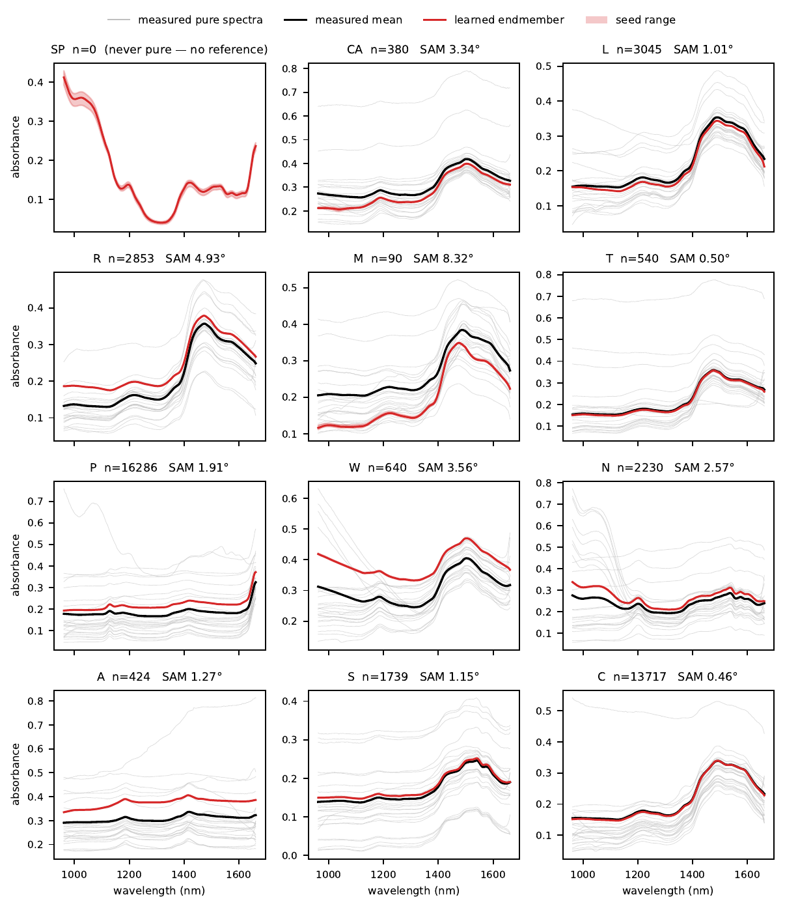
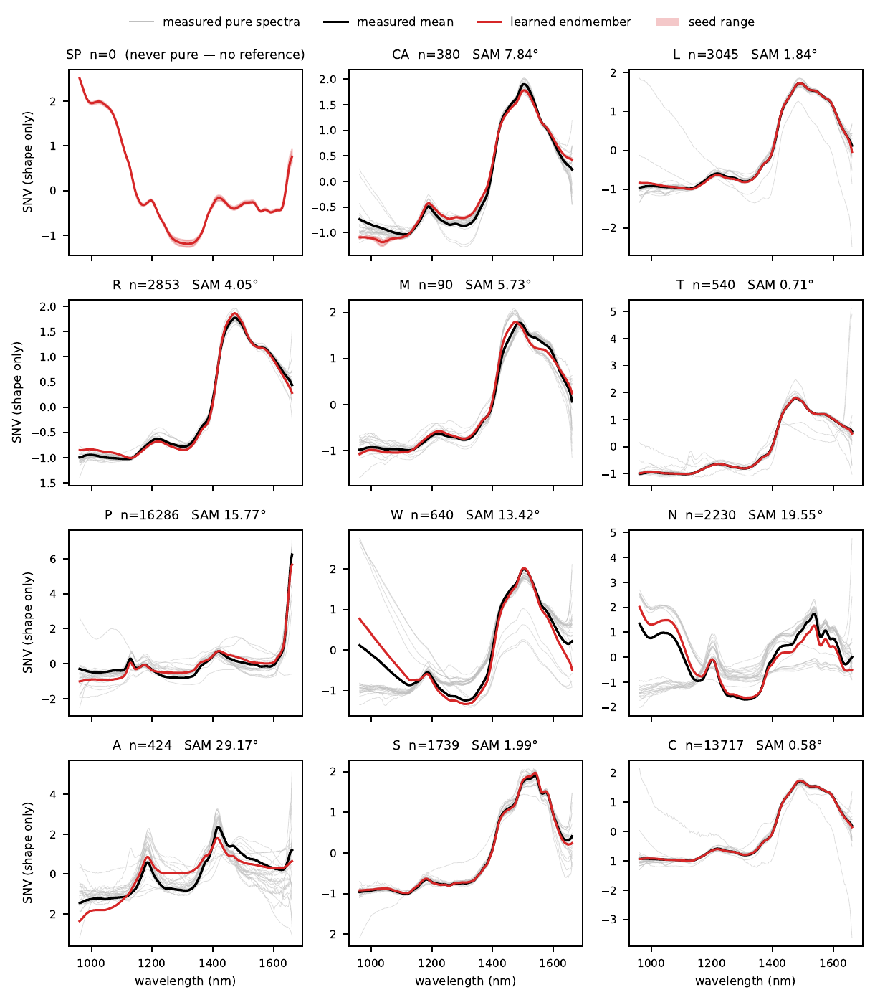

# Supplementary figures

Learned endmembers of the final configuration (3 seeds) against measured pure
spectra, absorbance channel, for all twelve fibres. Grey lines are a selection
of measured pure samples (training samples that are at least 99% one fibre), the
black line is the mean of all pure samples, the red line is the learned endmember averaged over
the three seeds, and the shading shows its range across seeds. Panel titles give
the number of pure samples (`n`) and the spectral angle (SAM) between the learned
endmember and the measured mean on this channel.

Fibres: spandex (SP), cashmere (CA), linen (L), rayon (R), modal (M), tencel (T),
polyester (P), wool (W), nylon (N), acrylic (A), silk (S), cotton (C).

## `endmembers_all_raw.pdf`: raw absorbance

This is the space the decoder is trained in and the space used for every number
in the paper. Spandex never occurs pure in the dataset, so it has no measured
reference; its endmember is learned from blends alone.

## `endmembers_all_snv.pdf`: shape only (SNV)

Standard normal variate (SNV) correction subtracts each spectrum's mean and
divides by its standard deviation, so this view compares shape only. Read it with
two cautions:

- For acrylic (A), nylon (N) and polyester (P), two real pure samples of the same
  fibre already differ by more than 20° after SNV (33°, 32° and 22°). SNV divides
  by a small standard deviation for these flat, low-contrast spectra and amplifies
  noise, so large angles here do not mean the endmember is wrong.
- For wool (W), most of the extra SNV disagreement sits at the short-wavelength
  end, where it comes from a baseline slope rather than from absorption bands.

For cotton, linen, tencel and silk, the absorption features line up closely in
this view.

Both figures are produced by
`python analysis/plot_endmembers.py --data_root data/FabricSpectra/ --ckpt <3 final checkpoints> --paper --save endmembers_all`.
